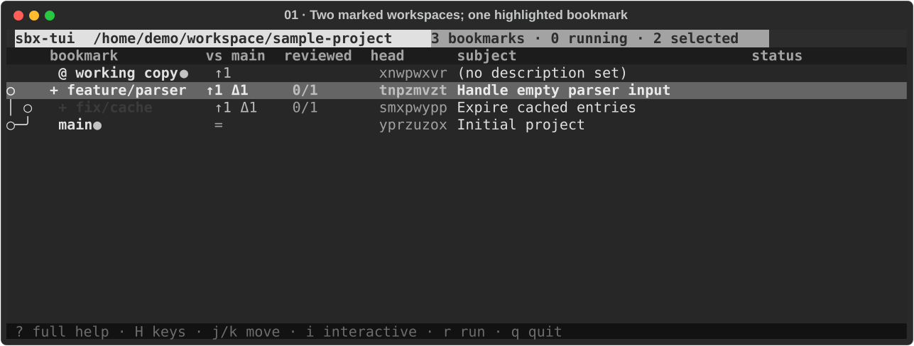
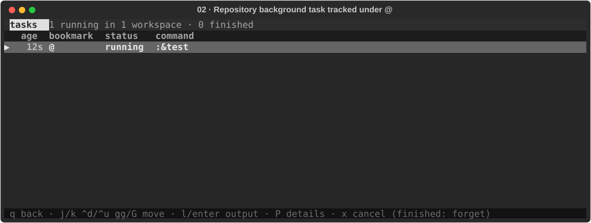
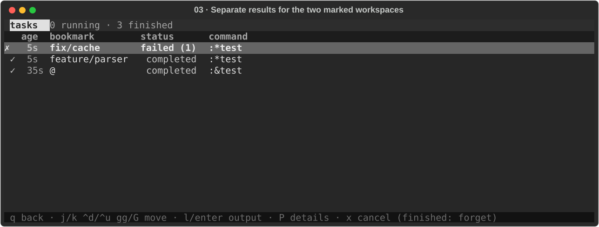
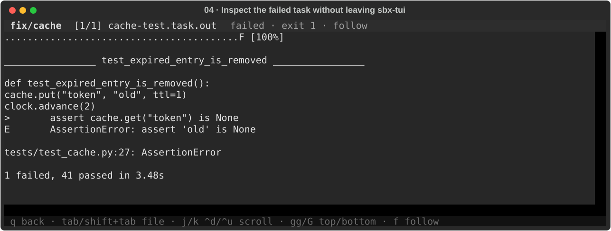

# Workflow: run tests while keeping sbx-tui open

This example follows a Python project from a quick foreground check to a
repository background task, then tests two bookmarks in parallel. It uses
`feature/parser` and `fix/cache` as example bookmarks; substitute your own.
The illustrations use the actual TUI renderer with staged project data and
test results. They show the workflow, not results from this repository's tests.

## 1. Define one test command

From your project directory, configure a reusable command:

```sh
sbx-tui config set --project commands.test 'uv run pytest -q'
sbx-tui
```

This adds `test = "uv run pytest -q"` under `[commands]` in the project
configuration. The project must already have pytest available through uv.
These commands run on the host; they do not launch a sandbox or an agent.

The following steps use `:test`, `:&test` and `:*test` to run this command in
the foreground, repository background and workspace background. See the
[command comparison](usage.md#choosing-how-to-run-a-shell-command) for the reference.

## 2. Do a quick foreground check

Press `:`, type `test`, and press `Enter`. The command takes over the terminal:

```text
── sbx-tui: :test → uv run pytest -q ──

..........................................                         [100%]
42 passed in 3.12s

── exited with 0; press Enter to return to sbx-tui ──
```

Press `Enter` at the exit prompt to return.

## 3. Run once in the repository background

Use `j` / `k` to move to `feature/parser` and press `Space` to mark it.
Move to `fix/cache` and mark it too. `Space` marks a row and moves down;
move back to `feature/parser` to leave it highlighted.

The marks are deliberately left in place for the next command:



*Two rows are marked, but `:&test` will ignore them.*

Enter `:&test` to launch **one task in the repository root**, then press `T`
to open the task list:



*The task belongs to `@`, even though `feature/parser` was highlighted.*

The TUI remains usable. In the task list, select the task and press `Enter`
or `l` to follow its captured output; `q` returns to the task list, and another
`q` returns to the bookmark list. Let this run finish before the next step.
Its result remains available in `T`.

## 4. Run in both marked workspaces

Back on the bookmark list, keep `feature/parser` and `fix/cache` marked and
enter `:*test`. This starts two background tasks, each in its own workspace.
sbx-tui creates a missing workspace before launching its task. For Python
projects, uv prepares that workspace's environment as needed.

Press `T` again. In this example, the parser tests pass and the cache tests fail:



*Three records: the earlier repository run, plus one run for each marked bookmark.*

## 5. Inspect the failure

In `T`, use `j` / `k` to select the failed `fix/cache` task, then press `Enter`:



*The log belongs to the selected task; the title identifies the bookmark and exit code.*

Use `j` / `k` to scroll, `gg` / `G` for the top or bottom, and `q` to go back.
For a running task, the log follows new output automatically.

To rerun just the cache tests after making a fix, return to the bookmark list,
press `Esc` to clear marks, highlight `fix/cache`, and enter `:*test` again.
Each invocation creates a new task record, so you can compare it with the
earlier failure in `T`.

For the complete controls, see [Tasks](usage.md#tasks) and the
[log viewer](usage.md#log-viewer).
