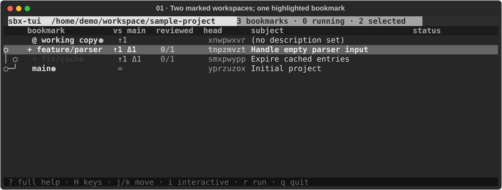
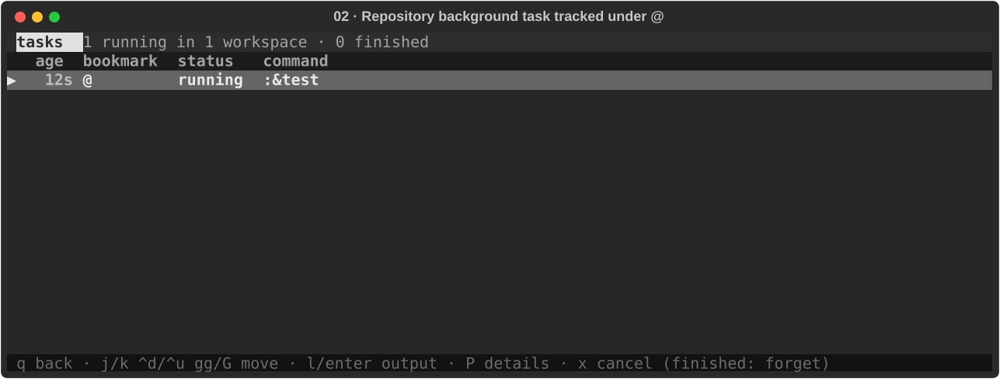
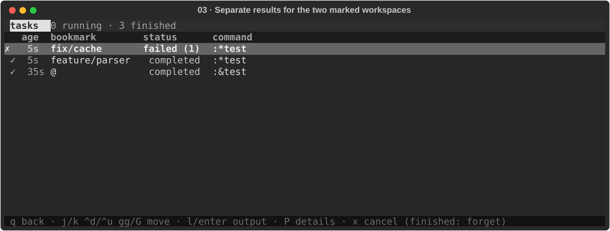
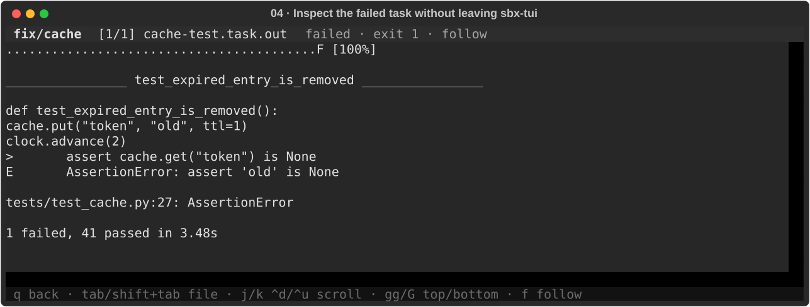

# Workflow: run tests while keeping sbx-tui open

This example follows a Python project from a quick foreground check to a
repository background task, then tests two bookmarks in parallel. It uses
`feature/parser` and `fix/cache` as example bookmarks; substitute your own.
The illustrations use the actual TUI renderer with staged project data and
test results. They show the workflow, not results from this repository's tests.

## 1. Define one test command

From your project directory, configure a reusable command:

```sh
sbx-tui config set --project commands.test 'uv run pytest -q'
sbx-tui
```

This adds `test = "uv run pytest -q"` under `[commands]` in the project
configuration. The project must already have pytest available through uv.
These commands run on the host; they do not launch a sandbox or an agent.

You can run the same configured command three ways:

| Enter in sbx-tui | Where the tests start | What you can do meanwhile |
|---|---|---|
| `:test` | Once in the repository root | Use the command's terminal; return when it exits |
| `:&test` | Once in the repository root, ignoring marks | Keep navigating sbx-tui |
| `:*test` | Once in each marked workspace, or the highlighted workspace if none are marked | Keep navigating sbx-tui |

The literal equivalents are `:!uv run pytest -q`, `:&!uv run pytest -q`,
and `:*!uv run pytest -q`. The prefix changes execution; the configured script
stays the same. See the [full comparison](usage.md#choosing-how-to-run-a-shell-command)
for environment variables and task persistence.

## 2. Do a quick foreground check

Press `:`, type `test`, and press `Enter`. The command takes over the terminal:

```text
── sbx-tui: :test → uv run pytest -q ──

..........................................                         [100%]
42 passed in 3.12s

── exited with 0; press Enter to return to sbx-tui ──
```

Press `Enter` to return. If the tests take longer than expected, `Ctrl+C`
interrupts them; press `Enter` at the exit prompt to return to the TUI.
An exit status of `-2` or `130` means the command was interrupted. This form
does not create a background task or a captured log in the task list.

## 3. Run once in the repository background

Use `j` / `k` to move to `feature/parser` and press `Space` to mark it.
Move to `fix/cache` and mark it too. `Space` marks a row and moves down;
move back to `feature/parser` to leave it highlighted.

The marks are deliberately left in place for the next command:



*Two rows are marked, but `:&test` will ignore them.*

Enter `:&test` to launch **one task in the repository root**, then press `T`
to open the task list:



*The task belongs to `@`, even though `feature/parser` was highlighted.*

The TUI remains usable. In the task list, select the task and press `Enter`
or `l` to follow its captured output; `q` returns to the task list, and another
`q` returns to the bookmark list. Let this run finish before the next step.
Its result remains available in `T`.

`:&test` does not create or enter the highlighted bookmark's workspace.
Use the `&` prefix as shown: a trailing shell `&` (`:!uv run pytest -q &`)
does not create a tracked sbx-tui task.

## 4. Run in both marked workspaces

Back on the bookmark list, keep `feature/parser` and `fix/cache` marked and
enter `:*test`. This starts two background tasks, each in its own workspace.
sbx-tui creates a missing workspace before launching its task. For Python
projects, uv prepares that workspace's environment as needed.

Press `T` again. In this example, the parser tests pass and the cache tests fail:



*Three records: the earlier repository run, plus one run for each marked bookmark.*

The separate results matter: a passing repository run says nothing about
changes that exist only in another bookmark's workspace. With no rows marked,
`:*test` runs only in the highlighted workspace. `Esc` on the bookmark list
clears marks when you want that single-workspace behavior.

## 5. Inspect the failure

In `T`, use `j` / `k` to select the failed `fix/cache` task, then press `Enter`:



*The log belongs to the selected task; the title identifies the bookmark and exit code.*

Use `j` / `k` to scroll, `gg` / `G` for the top or bottom, and `q` to go back.
For a running task, the log follows new output automatically.

To rerun just the cache tests after making a fix, return to the bookmark list,
press `Esc` to clear marks, highlight `fix/cache`, and enter `:*test` again.
Each invocation creates a new task record, so you can compare it with the
earlier failure in `T`.

## 6. Cancel or leave a task running

To stop a background task, open `T`, select its running row, and press `x`.
That targets just that task. If it does not stop, further presses escalate
from SIGINT to SIGTERM and SIGKILL. On a finished row, `x` forgets the task
and removes its captured output instead.

On the bookmark list, `x` acts on the target bookmarks and can affect several
running tasks or sandbox runs. Use the task list when you want to cancel only
one command.

Both `:&` and `:*` tasks keep running if you quit sbx-tui. Confirm the quit
prompt when tasks are still running; reopening sbx-tui in the same repository
lets you inspect their status and logs. Background commands capture output
and have no interactive input, so use the foreground form for commands that
need terminal interaction.

For the complete controls, see [Tasks](usage.md#tasks) and the
[log viewer](usage.md#log-viewer).
